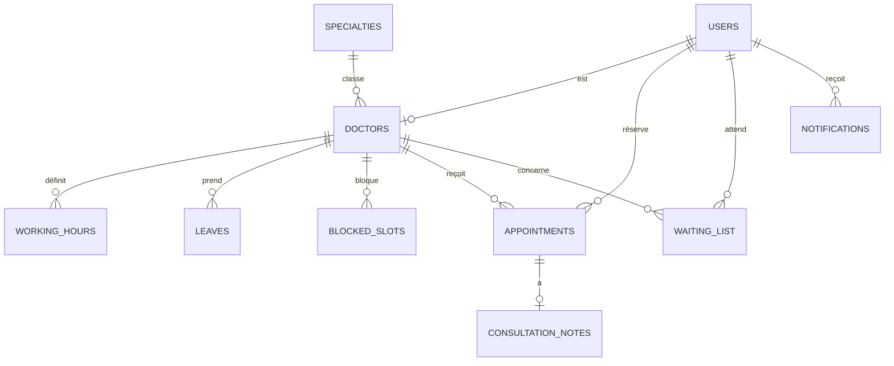

# Document de conception – ClinicRDV
> À copier dans Confluence.

## 1. Périmètre et rôles
Patient, Médecin, Administrateur/secrétaire. Données fictives uniquement.

## 2. Architecture
Mobile (React Native) → API REST (Express, JWT) → PostgreSQL.

## 3. Modèle de données
Voir `backend/db/schema.sql`. Tables : users, specialties, doctors, working_hours, leaves,
blocked_slots, appointments, consultation_notes, waiting_list, notifications.

## 4. Algorithme des créneaux disponibles
1. Récupérer les horaires de travail du jour de semaine.
2. Découper selon `consultation_minutes`.
3. Exclure : congés, créneaux bloqués, RDV pending/confirmed, créneaux passés.

## 5. Gestion de la concurrence
Contrainte d'exclusion PostgreSQL `no_double_booking` (plage temporelle par médecin).
Deux réservations simultanées : l'une réussit, l'autre reçoit HTTP 409 → écran « créneau indisponible ».

## 6. Sécurité
Mots de passe hachés (bcrypt), JWT, contrôle des rôles, validation zod, helmet, requêtes paramétrées (anti-injection SQL).

## 7. Choix techniques et justification
| Choix | Raison |
|-------|--------|
| PostgreSQL | Contrainte d'exclusion native pour les conflits |
| Express + zod | Simplicité, validation déclarative |
| Expo | Démarrage rapide, démo sur téléphone |

## 8. Répartition des tâches (Jira)
Voir README.
